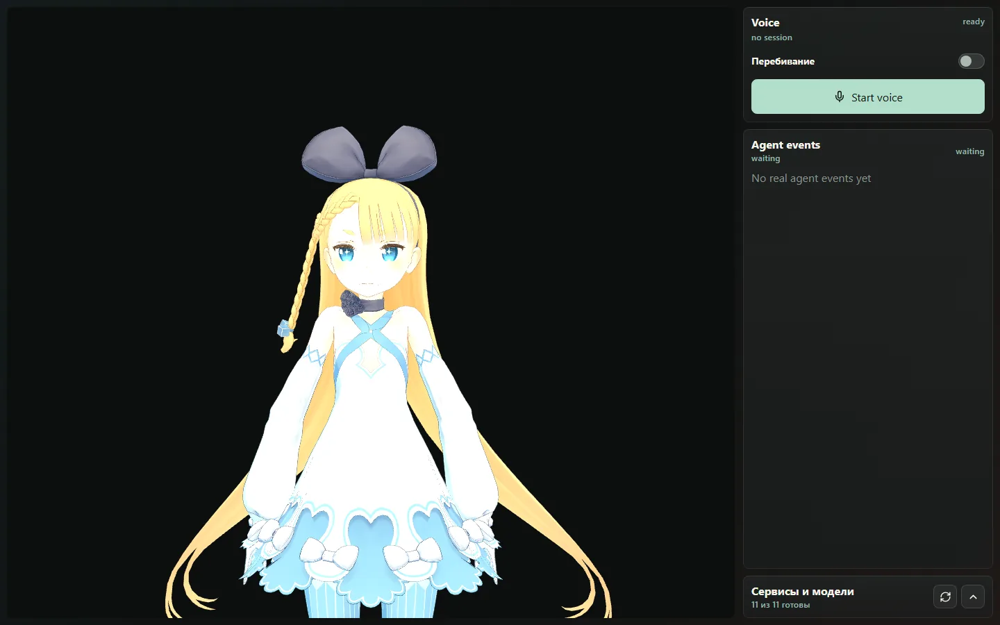
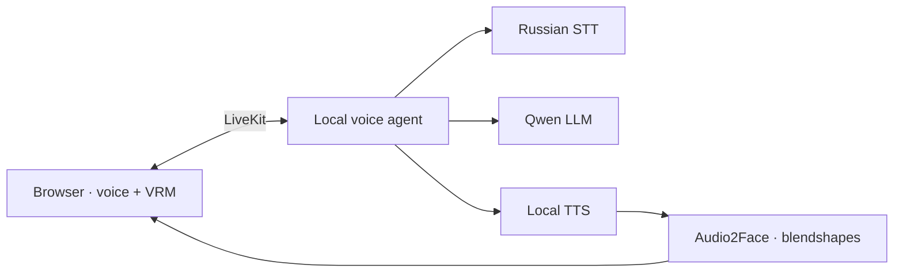

# Rula

**Local-first realtime Russian voice avatar with a browser VRM interface.**

Speak Russian. Get a local voice response from an animated avatar.

Rula connects local speech recognition, a Qwen language model, local speech synthesis and audio-driven facial animation through LiveKit. The browser renders a 3D VRM avatar; inference runs on a separate Windows / WSL2 / NVIDIA GPU workstation.

- **Voice interface:** Russian speech recognition, synthesis and interruption handling.
- **Local inference:** STT, LLM, TTS and face animation run in the local runtime.
- **Realtime contracts:** generation IDs, bounded playback and audio-face timing.
- **Open architecture:** FastAPI agent, React / Three.js client and shared event protocol.

**Development preview.** Rula is a demo / early runtime. GPU, latency, soak, licensing and air-gap qualification remain acceptance gates. The [project website](https://ykshv.github.io/rula/) is independent of the voice backend. The former public interactive demo at `ai.igor-ya.ru` is currently unavailable.



## Architecture



## Get started

```sh
git clone https://github.com/ykshv/rula.git
cd rula
```

Follow the [setup guide](https://ykshv.github.io/rula/quickstart/) for the GPU host, model downloads and local services. The default runtime uses local inference; Internet access is needed to obtain dependencies and model artifacts.

| Component | Current evidence |
| --- | --- |
| Public project website | Static documentation; independent of the interactive demo |
| Local voice-avatar runtime | Demo implementation; verify readiness on the target workstation |
| Production and air-gap use | Pending the [acceptance gates](https://ykshv.github.io/rula/verification/) |

## Author and related work

Created and maintained by [Igor Yakushev](https://igor-ya.ru/). Read the architecture article [On-prem voice agents](https://igor-ya.ru/posts/on-prem-voice-agents/) (Russian).

Related project: [Rokid Physical AI](https://github.com/ykshv/rokid-physical-ai) uses smart glasses as a voice-and-camera interface for robot arms.

[Documentation](https://ykshv.github.io/rula/) · [Русская инструкция](https://ykshv.github.io/rula/ru/) · [Architecture](https://ykshv.github.io/rula/architecture/) · [Contributing](CONTRIBUTING.md) · [License](LICENSE)

MIT covers this repository's code and documentation. Third-party models, avatar assets and external runtimes retain their own licenses. See [SECURITY.md](SECURITY.md) for reporting and scope.
