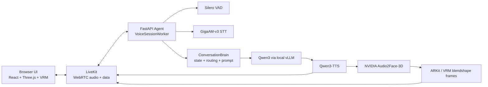

# Architecture

## Closed-Contour Runtime
The browser is only the demo client. The product boundary is the local runtime.

```text
microphone / local client
 -> local LiveKit media path
 -> local FastAPI voice runtime
 -> local STT / LLM / TTS / face-animation models
 -> local avatar or video output
```

Default runtime principles:

- No OpenAI, cloud STT, cloud TTS, or hosted avatar inference in the default path.
- Internet is required only to download model artifacts and upstream dependencies.
- Model weights live under `models/hf/` and are ignored by Git.
- Runtime state, logs, SQLite databases, generated media, and deployment secrets stay local.
- Browser rendering can be replaced by a kiosk app, native shell, Unreal/Unity scene, or video-avatar renderer.
- Air-gap checks are part of acceptance, not a documentation afterthought.

## Architecture


Current visual path:

```text
TTS audio -> Audio2Face-3D -> blendshape envelopes -> Three.js VRM avatar
```

Future realistic-video path:

```text
TTS audio -> audio-to-video model -> video frames -> WebRTC video track
```

## Engineering Highlights
Rula is intentionally shaped as a realtime systems project, not a thin wrapper around model calls.

- **Modular monolith core:** domain state, API, media runtime, metrics, and model adapters stay in one deployable boundary until measured scale pressure appears.
- **Explicit turn state machine:** `SessionStateMachine` owns `turn_id`, `generation_id`, `branch_state`, interrupts, speculative branches, and stale artifact rejection.
- **Shared wire protocol:** Python emits `StreamEnvelope`; TypeScript consumes the same event shape from `packages/avatar_protocol`.
- **Speculative turn-taking:** `TurnPolicy` can start early generation after a silence window and discard it if the user resumes speaking.
- **Two-phase barge-in:** playback ducks quickly, then STT verifies whether the burst is a real interruption or echo/noise.
- **Audio-first hot path:** `AudioPacer` owns the continuous 20 ms LiveKit audio stream; face frames and metrics stay off the critical path.
- **Clause-level streaming:** Qwen text is chunked into speakable clauses so TTS can start before the full answer is complete.
- **Client-side face anchoring:** the browser anchors `pts_ms` to the moment audio is actually heard, reducing mouth drift under jitter.
- **Fail-closed readiness:** `/ready` reports voice-avatar readiness only when artifacts, local services, GPU headroom, LiveKit, and voice engines are healthy.

## Agent Brain
The agent brain is a deterministic dialogue runtime around a local LLM. The LLM generates dialogue text; the runtime owns state, timing, cancellation, media, and safety boundaries.

```text
transcribed user turn
 -> ConversationBrain
 -> IntentRouter
 -> StateReducer
 -> ResponsePlanner
 -> direct response or Qwen3 LLM stream
 -> clause chunker
 -> Qwen3-TTS
 -> Audio2Face / avatar output
```

The brain keeps session-local memory, routes latency-critical intents before the LLM, composes a compact Russian voice prompt, emits direct deterministic answers when useful, and drops stale `generation_id` data at every hop.

## Model Stack
| Layer | Model / runtime | Used for | Source |
|---|---|---|---|
| LLM | `Qwen/Qwen3-14B-FP8` | Local dialogue model served by vLLM | [Hugging Face](https://huggingface.co/Qwen/Qwen3-14B-FP8) |
| LLM fallback | `Qwen/Qwen3-14B` | Optional non-FP8 fallback | [Hugging Face](https://huggingface.co/Qwen/Qwen3-14B) |
| TTS | `Qwen/Qwen3-TTS-12Hz-1.7B-CustomVoice` | Russian speech synthesis / avatar voice | [Hugging Face](https://huggingface.co/Qwen/Qwen3-TTS-12Hz-1.7B-CustomVoice) |
| STT | `ai-sage/GigaAM-v3` | Russian speech recognition | [Hugging Face](https://huggingface.co/ai-sage/GigaAM-v3), [GitHub](https://github.com/salute-developers/GigaAM) |
| Face animation | `nvidia/Audio2Face-3D-v3.0` | Audio-driven 3D facial animation | [Hugging Face](https://huggingface.co/nvidia/Audio2Face-3D-v3.0), [NVIDIA NGC](https://catalog.ngc.nvidia.com/orgs/nim/teams/nvidia/containers/audio2face-3d) |
| VAD | `silero-vad` | Voice activity detection / turn-taking | [GitHub](https://github.com/snakers4/silero-vad) |
| Avatar | Alicia Solid VRM 0.51 | Default replaceable VRM avatar | [UniVRM asset](https://github.com/vrm-c/UniVRM/blob/master/Tests/Models/Alicia_vrm-0.51/AliciaSolid_vrm-0.51.vrm) |
| Realtime transport | LiveKit | WebRTC audio/data room | [LiveKit](https://github.com/livekit/livekit), [Docs](https://docs.livekit.io/intro/overview/) |
| LLM serving | vLLM OpenAI-compatible server | Local `/v1` LLM API shape only | [vLLM docs](https://docs.vllm.ai/en/stable/serving/openai_compatible_server/) |
| VRM rendering | `@pixiv/three-vrm` + Three.js | Browser-side avatar runtime | [three-vrm](https://github.com/pixiv/three-vrm) |

The OpenAI-compatible API shape is local vLLM compatibility. The default runtime does not call OpenAI cloud inference.

## Runtime Contracts
Every hot-path event or chunk carries:

```text
session_id, turn_id, generation_id, branch_state, seq, pts_ms?
```

When the user interrupts, `generation_id` advances. Any stale audio, text, face frame, or avatar event from an older generation must be dropped silently. This invariant keeps realtime playback, barge-in, and avatar animation coherent.

## Repository Layout
```text
apps/agent/                  FastAPI agent and realtime voice runtime
apps/web/                    React + Three.js + VRM browser UI
packages/avatar_protocol/    Typed event/data-channel protocol
profiles/                    Hardware/runtime profiles
models/manifests/            Versioned model/avatar manifests only
scripts/models/              Model download and verification scripts
scripts/evals/               GPU, latency, legal, and soak checks
infra/wsl/                   Local WSL/Docker runtime
```
